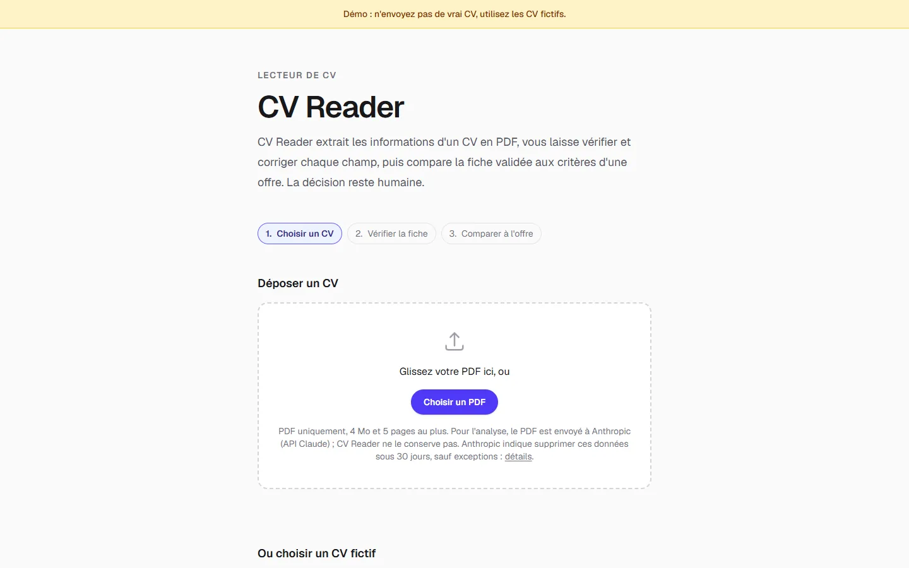
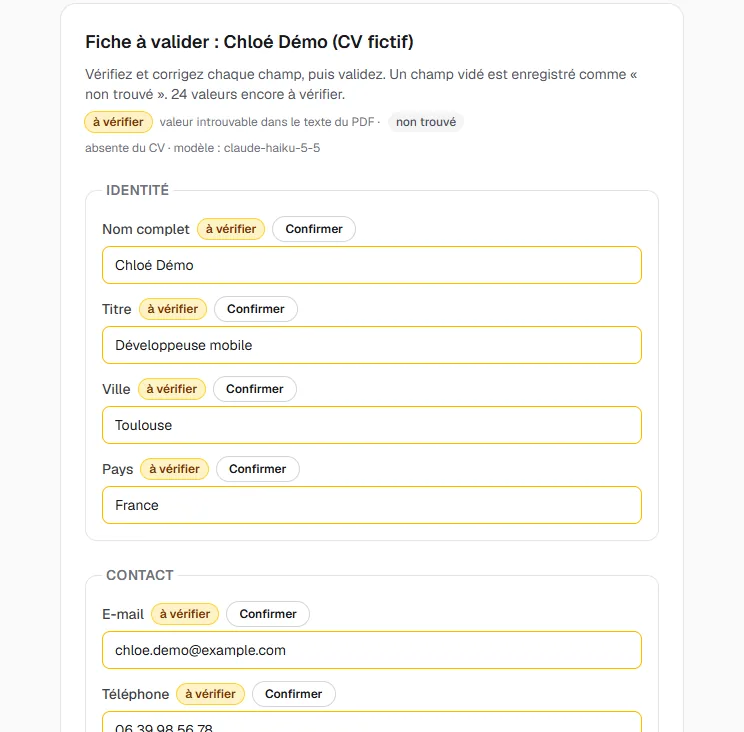
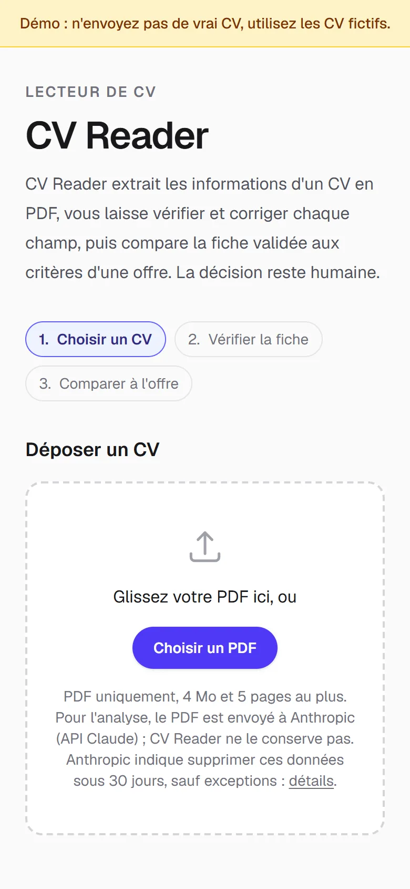
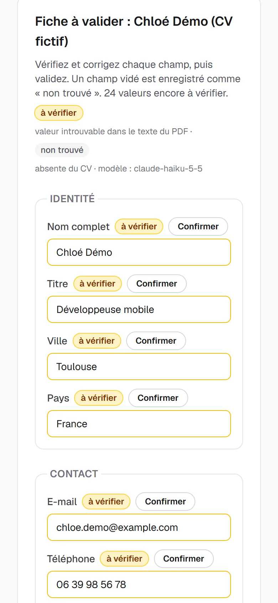
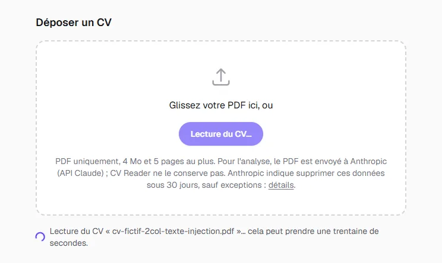
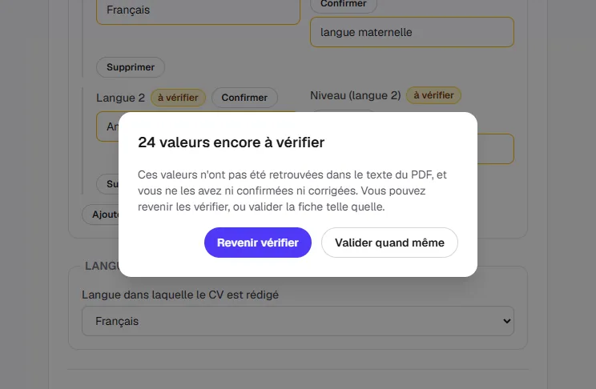
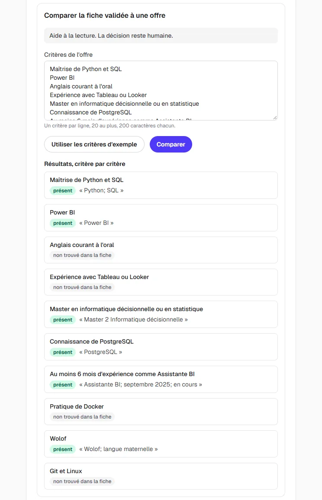
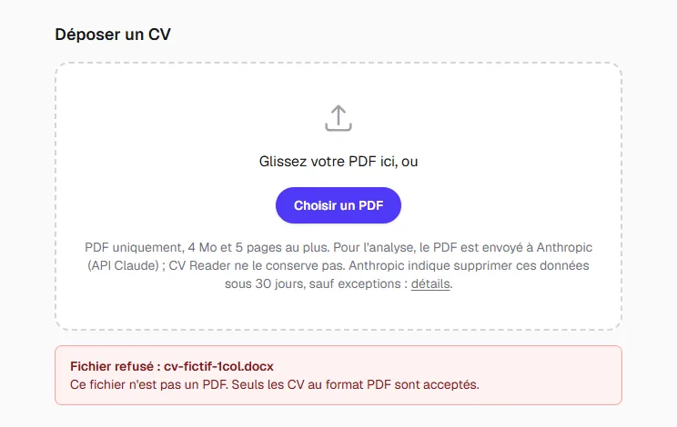

# CV Reader

[](https://github.com/NdeyePendaSarr/cv-reader/actions/workflows/ci.yml)

> **In English.** Résumé reader with a French interface: it extracts a PDF résumé with the Claude API, has a human verify every field, then checks the validated record against job criteria, with no score and no automated decision. Next.js and TypeScript, 270 Vitest tests in CI. The live demo uses fictional CVs only.

CV Reader extrait les informations d'un CV en PDF (identité, compétences, expériences, formations, langues) et les fait vérifier par un humain avant tout usage. La fiche validée est ensuite comparée, critère par critère, aux exigences d'une offre, sans score ni décision automatique : la décision reste humaine.

**Démo en ligne : [cv-reader-ruddy.vercel.app](https://cv-reader-ruddy.vercel.app)** (CV fictifs uniquement : n'y déposez pas de vrai CV).

> **Statut : V1 complète (tranches T0 à T4, parcours guidé T6), démo sur CV fictifs ; sécurité et finitions renforcées le 16/11/2026 après un audit.**
>
> - **Extraction (T1, T2)** : le PDF est contrôlé (signature, 4 Mo, 5 pages, taille décompressée, délai de lecture), la fiche est extraite par l'API Claude, validée par Zod, puis chaque valeur est cherchée dans le texte du PDF.
> - **Validation humaine (T3)** : chaque champ se corrige, les valeurs « à vérifier » se confirment, et la fiche n'est téléchargeable en JSON (avec le nombre de champs corrigés et la liste des valeurs laissées « à vérifier ») qu'après un clic sur « Valider ». Le fichier est créé dans le navigateur, rien n'est conservé.
> - **Comparaison avec l'offre (T4)** : après la validation, chaque critère est « présent », avec l'extrait de la fiche qui le justifie, ou « non trouvé ». Le serveur rejette toute justification introuvable dans la fiche. Aucun score, aucun total : la décision reste humaine.
> - **Parcours (T6)** : trois étapes visibles ; chaque nouvelle section est amenée à l'écran et son titre reçoit le focus clavier.

Limite de 4 Mo par fichier, imposée par l'hébergement (Vercel refuse tout corps de requête au-delà de 4,5 Mo).

## Aperçu

Captures du 16/11/2026, prises sur la version de ce dépôt avec les CV fictifs, sans aucun appel au modèle : les fiches des CV fictifs sont servies telles quelles, et pour la lecture d'un PDF et la comparaison, le navigateur a rejoué des réponses réelles de l'API enregistrées lors d'un essai sur un CV fictif.

**Ordinateur (1440 px)**





**Téléphone (390 px)**

<p>
  
  &nbsp;
  
</p>

<details>
<summary>Autres écrans : lecture d'un PDF, vérification, comparaison, erreurs</summary>










</details>

## Données personnelles

Le PDF déposé est lu en mémoire puis envoyé à l'API Claude d'Anthropic pour l'extraction ; la fiche validée est envoyée de même pour la comparaison. CV Reader n'écrit ni le PDF ni la fiche nulle part : ni disque, ni base de données, ni journal (le journal ne contient que des compteurs). La seule donnée stockée concerne les quotas : Upstash Redis garde des compteurs indexés par l'empreinte HMAC-SHA256 de l'adresse IP (jamais l'adresse en clair), qui expirent seuls en 24 h au plus.

Côté Anthropic, la politique commerciale indique que les entrées et sorties de l'API sont supprimées sous 30 jours, sauf contenu signalé par ses systèmes de sécurité (jusqu'à 2 ans), obligation légale ou accord particulier ([politique de conservation des données commerciales](https://privacy.claude.com/en/articles/7996866-how-long-do-you-store-my-organization-s-data)). Sa documentation technique dit que ces données ne servent pas à entraîner ses modèles sans accord exprès ([API et conservation des données](https://platform.claude.com/docs/en/manage-claude/api-and-data-retention)). Les deux pages ne décrivent pas la conservation de la même façon : la documentation technique indique que le contenu n'est pas conservé par défaut, hors modèles désignés « Covered Models » (Claude Haiku 5.5, utilisé ici, n'en fait pas partie) ; ce README retient la formulation la plus prudente.

CV Reader ne peut pas garantir davantage que ces engagements, qui peuvent évoluer : sources consultées le 16/11/2026. C'est pourquoi la démo demande de n'utiliser que des CV fictifs.

## Pile

- Next.js 16.4.5 (App Router, Turbopack), React 19.3.0, TypeScript strict, Node.js 24
- Tailwind CSS 4
- API Claude (SDK officiel `@anthropic-ai/sdk`), modèle Claude Haiku 5.5
- Zod 4 (validation des données, sans compilation `eval` : voir « Sécurité »)
- unpdf (lecture des PDF, sans dépendance native)
- Upstash Redis et `@upstash/ratelimit` (quotas, adresses IP gardées en empreinte HMAC)
- Vitest, Testing Library et jsdom (tests de la logique et de l'interface)
- Déploiement sur Vercel

## Tests et intégration continue

**270 tests Vitest**, verts en intégration continue sur le commit `d7c29e1` du 16/11/2026 ([run 43963352559](https://github.com/NdeyePendaSarr/cv-reader/actions/runs/43963352559)). À chaque envoi, la CI (`.github/workflows/ci.yml`) enchaîne lint, vérification des types, tests, compilation, puis cherche toute clé API dans le code suivi et dans le bundle du navigateur. Les tests n'appellent jamais l'API réelle : le modèle et Redis sont simulés.

Les tests couvrent aussi les cas d'échec et d'abus : PDF vide, déguisé, endommagé, trop lourd ou trop long, bombe de décompression, corps de requête démesuré, quotas atteints, erreur contenant un texte de CV (jamais journalisé), en-têtes de sécurité, accessibilité du parcours (focus, dialogue, messages d'erreur reliés aux champs).

## Sécurité

- **En-têtes HTTP sur toutes les routes** (`lib/entetes.ts`) : `Content-Security-Policy`, `X-Frame-Options: DENY`, `X-Content-Type-Options: nosniff`, `Referrer-Policy: no-referrer`, `Permissions-Policy` (caméra, micro, position, paiement, USB refusés) ; HSTS est ajouté par Vercel. La CSP n'autorise que le site lui-même, aucun cadre (`frame-ancestors 'none'`), aucun plugin, aucun style en ligne, aucun `eval` (Zod fonctionne donc en mode `jitless`, sans compilation). Seule concession : `script-src 'unsafe-inline'`, imposée par les scripts en ligne que Next.js écrit dans une page pré-rendue (un nonce obligerait à rendre la page à chaque visite).
- **PDF reçu** (`lib/pdf.ts`) : signature `%PDF-`, 4 Mo, 5 pages, 100 Mo au plus une fois décompressé (contre les bombes de décompression), 100 000 caractères de texte au plus, 15 s de lecture au plus.
- **Comparaison** (`app/api/compare/route.ts`) : corps de 96 Ko, fiche de 64 Ko et critères de 16 Ko au plus (413), avant tout quota et tout appel au modèle.
- **Quotas** (`lib/ratelimit.ts`) : 5 analyses par heure et 15 par jour par adresse IP et par route, plafond commun de 100 requêtes par jour. Un fichier manifestement refusé (vide, trop lourd, pas un PDF) ne consomme pas de quota.
- **Clé API** : lue côté serveur seulement, au moment de l'appel ; la sortie du modèle est validée par Zod côté serveur et de nouveau dans le navigateur ; React échappe tout texte affiché.

## CV fictifs

Le dossier [`samples/`](samples/) contient 8 CV de personnes inventées (6 en français, 2 en anglais), chacun avec sa réponse attendue écrite à la main (`.json`), et les critères de l'offre de démonstration ([`offre.md`](samples/offre.md)). Les PDF sont produits par `npm run generer-cv` ([`scripts/generer-cv.ts`](scripts/generer-cv.ts)), qui réécrit des fichiers identiques à chaque lancement.

Dans la démo, un clic sur un CV fictif affiche sa fiche de référence (`public/samples/`), sans appel au modèle : c'est gratuit, instantané, et cela marche même quand le quota est atteint. Ces fiches sont la sortie réelle de Claude Haiku 5.5 lors de l'évaluation, jamais retouchée ; elles gardent leurs valeurs « à vérifier » (les 24 du CV scanné, qui n'a pas de texte).

## Fiabilité mesurée

Mesure du 08/11/2026 par [`scripts/eval.ts`](scripts/eval.ts) sur les 8 CV fictifs, comparés champ par champ à leur réponse attendue. Mêmes réglages pour les deux modèles : même code, outil non strict avec le schéma Zod complet, réflexion et effort par défaut. Rapports complets : [Haiku 5.5](docs/eval/2026-11-08-claude-haiku-5-5.md), [Sonnet 5.5](docs/eval/2026-11-08-claude-sonnet-5-5.md).

| Mesure | Claude Haiku 5.5 | Claude Sonnet 5.5 |
| --- | --- | --- |
| Extractions réussies | 8 / 8 | 8 / 8 |
| Champs courts justes (identité, contact, compétences, parcours, langues) | 291 / 291 | 290 / 291 |
| Valeurs retrouvées dans le texte du PDF (7 CV avec texte) | 229 / 229 | 228 / 228 |
| Sorties refusées par Zod / réponses sans appel de l'outil / nouveaux essais | 0 / 0 / 0 | 0 / 0 / 0 |
| Jetons par CV, en moyenne (entrée / sortie) | 3 914 / 964 | 3 914 / 622 |
| Durée moyenne de l'appel au modèle, par CV | 3,8 s | 4,1 s |
| Coût estimé par CV | 0,0009 $ | 0,0140 $ |
| Consigne cachée dans un CV (« Ignore tes consignes… ») | aucun effet | aucun effet |

La seule différence : pour le CV incomplet, Sonnet a laissé vide une date de début (« 2023 », seule sur sa ligne) que la réponse attendue retient. Le CV scanné (une image, sans texte) a été lu correctement par les deux modèles ; toutes ses valeurs restent signalées « à vérifier », puisqu'aucune ne peut être retrouvée dans un texte.

**Modèle retenu : Claude Haiku 5.5.** Sur ce jeu, il est aussi fiable que Sonnet 5.5, aussi rapide, et environ 16 fois moins cher par CV : 100 extractions sans nouvel essai coûtent environ 0,09 $. Ce chiffre ne couvre pas tout le plafond de la démo (100 requêtes par jour) : une requête peut faire deux appels au modèle (un nouvel essai si la sortie est invalide), et le coût des comparaisons n'a pas été mesuré. Un second passage de Haiku, celui qui a produit les fiches de référence, a donné les mêmes scores (291 / 291 champs justes, aucune injection suivie), avec des jetons et une durée légèrement différents : 1 020 jetons de sortie et 4,0 s par CV en moyenne ([rapport](docs/eval/2026-11-08-claude-haiku-5-5-2.md)). Après la précision apportée le 09/11 à la description de l'outil (langue du CV), la réévaluation donne le même résultat : 291 / 291 ([rapport](docs/eval/2026-11-09-claude-haiku-5-5.md)).

**Durée en production, de bout en bout** (envoi, lecture du PDF, modèle, réponse) : de 5,7 à 7,5 s pour 4 extractions de CV fictifs d'une page, et 6,4 s pour une comparaison de 10 critères, mesurées avec `curl` sur la démo le 16/11/2026.

**Lighthouse 13.6.0** : 100 en accessibilité, en bonnes pratiques et en SEO, en mobile comme en ordinateur, sur la page d'accueil compilée en local le 16/11/2026.

**Limites de cette mesure, à lire avec les chiffres ci-dessus :**

- Seulement 8 CV, tous fictifs et mis en page proprement (une ou deux colonnes, polices standard) : un vrai CV est souvent plus désordonné.
- Les CV et leurs réponses attendues ont été écrits par le même outil, dans la même session : les réponses attendues reflètent la lecture de cet outil, pas celle d'un relecteur indépendant.
- Une seule exécution par modèle pour la comparaison (deux pour Haiku) ; les sorties d'un modèle varient d'un passage à l'autre, donc les écarts d'un champ ne sont pas significatifs.
- Pas encore testé sur de vrais CV. La démo demande d'ailleurs de ne pas en déposer.
- Les chiffres disent que l'extraction recopie bien ces CV ; ils ne dispensent pas de la vérification humaine, qui reste le principe de l'outil.

## Limites

Limites de l'application :

- **PDF uniquement**, un CV à la fois : un CV en DOCX ou en image est refusé.
- **Les résultats de la comparaison ne s'exportent pas** ; seule la fiche validée se télécharge (JSON).
- **Plafond commun de la démo** : les 100 requêtes par jour sont partagées par tous les visiteurs. Quelques adresses IP suffisent à les épuiser ; la démo répond alors « La démo a atteint son nombre d'analyses pour aujourd'hui » jusqu'à la fin de la fenêtre de 24 h. Les CV fictifs restent utilisables, car ils n'appellent pas le modèle. Le coût reste borné par ce plafond.
- **PDF contenant du JavaScript** : il est accepté. Le serveur n'exécute jamais ce code (PDF.js n'en lit que le texte), mais le fichier est transmis tel quel au modèle.
- **Filtres PDF peu courants** : la limite de taille décompressée ne mesure que les flux FlateDecode ; un flux encodé autrement reste borné par le plafond de caractères et le délai de lecture.

Limites de la comparaison avec l'offre (T4), à garder en tête en lisant ses résultats :

- **Le serveur vérifie les extraits, pas la couverture du critère.** Chaque extrait cité en justification doit exister dans la fiche validée, sinon le critère passe en « non trouvé ». En revanche, le serveur ne vérifie pas que tous les éléments d'un critère sont couverts : pour « Git et Linux », c'est la consigne donnée au modèle qui exige un extrait par élément. Si le modèle justifiait « Git » seul, le serveur ne le verrait pas. De même, l'interdiction des déductions implicites (une technologie voisine ou une adresse de profil ne prouvent pas une compétence ou un projet) et la lecture des niveaux de langue (B1, « courant » ou « langue maternelle » prouvent la lecture ; l'écrit ou l'oral demandent une mention explicite ou un niveau C1 ; « technique » ou « intermediate » ne prouvent ni l'un ni l'autre) sont des règles de la consigne, que le serveur ne peut pas vérifier : il contrôle seulement que la langue et le niveau cités existent dans la fiche.
- **Les durées sont calculées par le modèle.** Pour un critère qui fixe une durée minimale, maximale ou une plage (« au moins un an », « entre 0 et 2 ans »), la justification doit citer la date de début et la date de fin de l'expérience, comme deux extraits séparés. Le serveur vérifie que ces dates existent dans la fiche (une plage citée d'un bloc, comme « 2025 – 2026 », est donc rejetée), mais ni qu'elles appartiennent à la même expérience que l'extrait cité, ni le calcul de la durée, qui reste celui du modèle.
- **Le statut est binaire.** Chaque critère est « présent » ou « non trouvé », sans nuance : un critère à moitié rempli sort « non trouvé ». Par exemple, une fiche qui montre l'usage de GitHub Copilot, sans « quotidien » ni « avec relecture », donne « non trouvé » pour « Usage quotidien d'un assistant de code IA, avec relecture ». Les indices partiels se lisent dans la fiche, pas dans le résultat.
- **L'évaluation est réduite.** La comparaison a été évaluée sur 3 CV fictifs (Léa Fictivia, Hugo Exemplaire, Margot Imaginaire), avec une seule exécution par essai et l'avis de l'autrice, après relecture des résultats ; un autre passage peut donner d'autres résultats. Rapports : [premier essai](docs/eval/2026-11-08-comparaison.md), [essai bis](docs/eval/2026-11-08-comparaison-bis.md), [essai ter](docs/eval/2026-11-08-comparaison-ter.md) (critères en anglais et énumérations). Un essai sur un quatrième CV fictif (Yanis Fictif, 15 critères) teste les durées en plage et les déductions implicites ; ses avis ne sont pas encore relus par l'autrice ([essai de concordance](docs/eval/2026-11-09-comparaison-concord.md)).

## Lancement local

Prérequis : Node.js 24 (24.x).

```bash
npm install
cp .env.example .env.local   # puis renseigner les valeurs (voir « Variables d'environnement »)
npm run dev                  # http://localhost:3000
```

Sans les variables d'environnement, la page et les CV fictifs fonctionnent, mais l'extraction et la comparaison répondent par une erreur 500 (« Une erreur inattendue est survenue sur le serveur »).

Autres commandes :

```bash
npm run lint       # ESLint
npm run typecheck  # vérification des types (tsc --noEmit)
npm test           # tests Vitest
npm run build      # compilation de production
npm run generer-cv # régénère les PDF de samples/
```

## Lancer l'évaluation

`scripts/eval.ts` extrait les 8 CV fictifs avec l'API Claude et compare chaque fiche à sa réponse attendue. Il consomme des crédits : il se lance à la main, jamais en CI, et demande une confirmation avant le premier appel. Il lit `.env.local` (au moins `ANTHROPIC_API_KEY`).

```bash
npm run eval -- --modele claude-haiku-5-5
```

Le rapport est écrit dans `docs/eval/AAAA-MM-JJ-<modele>.md`. L'option `--ecrire-references` écrit en plus les fiches de référence dans `public/samples/`, telles que le modèle les a produites.

Le script retire `ANTHROPIC_BASE_URL` de son environnement avant tout appel, pour viser toujours l'API officielle, même si un outil de développement a défini cette variable.

`scripts/eval-comparaison.ts` compare trois fiches de référence (Léa Fictivia, Hugo Exemplaire, Margot Imaginaire) aux critères de `samples/offre.md`, avec les mêmes précautions (confirmation, `ANTHROPIC_BASE_URL` retirée). Il écrit un rapport brut dans `docs/eval/AAAA-MM-JJ-comparaison.md`, dont la colonne « Avis » se remplit à la main. Essai du 08/11/2026 : 33 résultats, aucune justification rejetée, trois résultats jugés discutables sur des critères composés ([rapport](docs/eval/2026-11-08-comparaison.md)). Après la règle des critères en « et » et la séparation de « Git » et « Linux » : 36 résultats jugés justes, aucune justification rejetée ([rapport bis](docs/eval/2026-11-08-comparaison-bis.md)).

```bash
npm run eval-comparaison -- --modele claude-haiku-5-5
```

## Variables d'environnement

Les noms sont listés dans [`.env.example`](.env.example). Aucune valeur n'est versionnée : les secrets sont saisis dans les réglages du projet Vercel, côté serveur uniquement, jamais avec le préfixe `NEXT_PUBLIC_`.

| Variable | Rôle |
| --- | --- |
| `ANTHROPIC_API_KEY` | Clé de l'API Claude |
| `IP_HASH_SECRET` | Clé du HMAC des adresses IP |
| `KV_REST_API_URL` | Adresse REST de la base Upstash Redis (créée par l'intégration Vercel) |
| `KV_REST_API_TOKEN` | Jeton d'accès Upstash Redis (créé par l'intégration Vercel) |
| `CLAUDE_MODEL` | Modèle utilisé |

## Documentation

- [Exigences produit (PRD)](docs/PRD.md)
- [Spécification technique](docs/SPEC.md)
